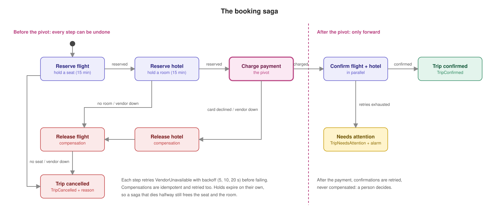
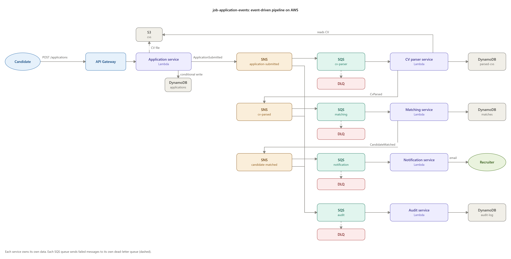
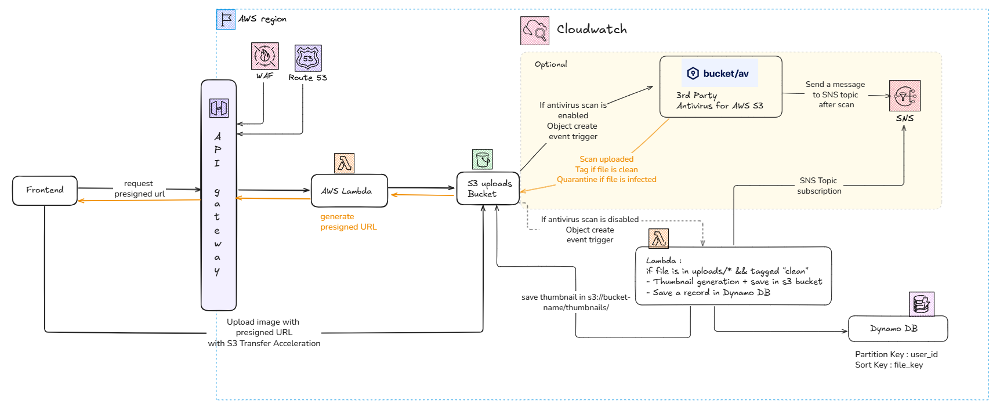
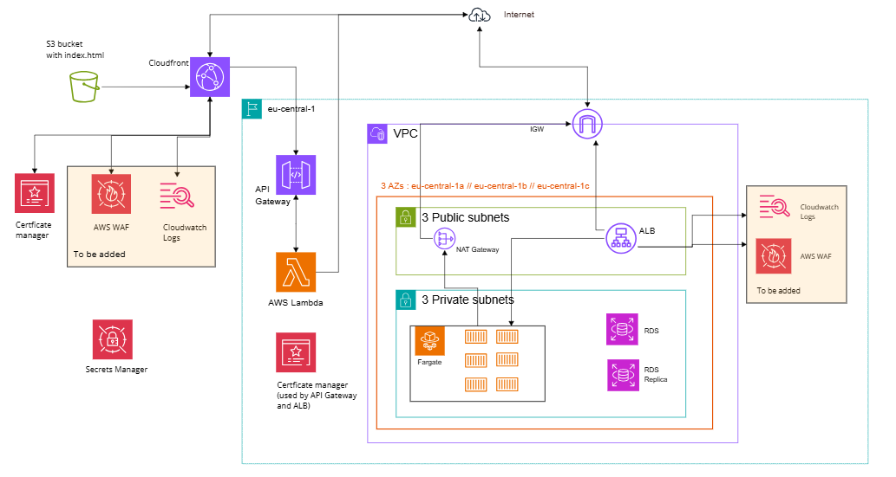
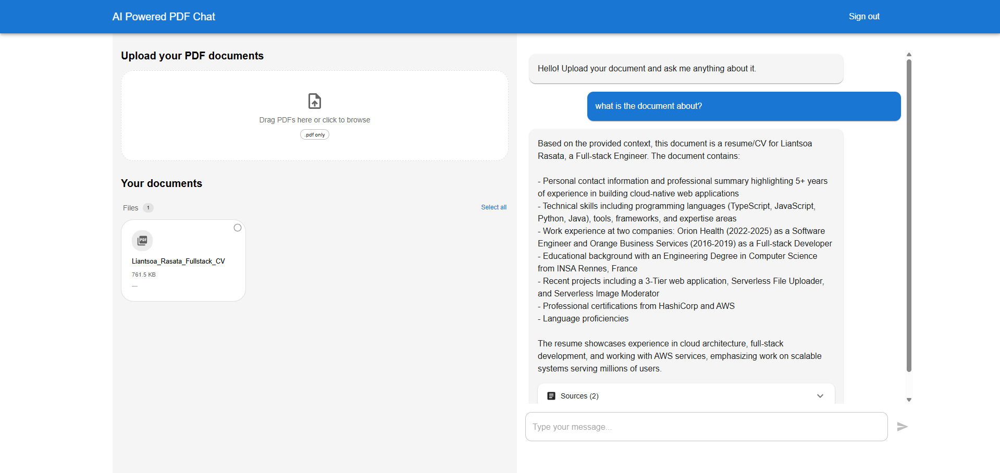
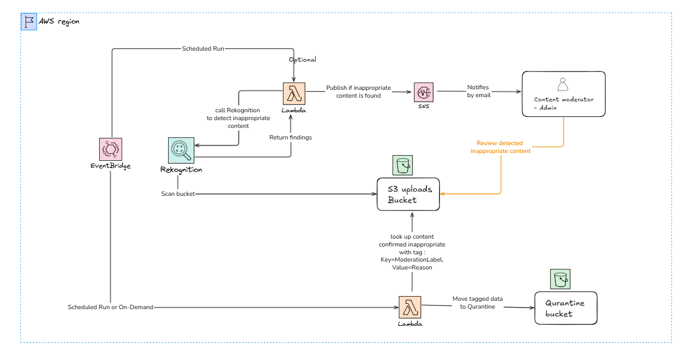

  <h1>Hi there! </h1>
  

    I'm <strong>Liantsoa</strong> — a Full-Stack Engineer who builds and ships in the cloud ☁️. AWS Certified, systems thinker, and always thinking about how the whole thing fits together.
  

## Tech Stack

### ☁️ Cloud & DevOps

### ⚙️ Backend

### 🎨 Frontend

---

<h2>📝 Latest Blog Posts</h2>

<ul>
  <li>
    <a href="https://medium.com/@rmliantsoa/the-orchestrated-saga-explained-with-a-london-weekend-39ba1ad16d24">The Orchestrated Saga, Explained with a London Weekend</a> — Nov 21, 2026 • 5 min read
  </li>
  <li>
    <a href="https://medium.com/@rmliantsoa/your-sqs-consumer-will-process-the-same-message-twice-is-your-code-ready-690f24283a75">Your SQS Consumer Will Process the Same Message Twice. Is Your Code Ready?</a> — Oct 24, 2026 • 5 min read
  </li>
  <li>
    <a href="https://medium.com/@rmliantsoa/building-a-rag-system-from-scratch-9-lessons-from-a-real-project-d5ec4555580b">Building a RAG System from Scratch: 9 Lessons from a Real Project</a> — Apr 10, 2026 • 6 min read
  </li>
  <li>
    <a href="https://medium.com/@rmliantsoa/how-to-design-a-system-when-you-dont-know-where-to-start-6d83ea324bdb">How to Design a System When You Don't Know Where to Start</a> — Feb 24, 2026 • 4 min read
  </li>
  <li>
    <a href="https://medium.com/@rmliantsoa/understanding-kubernetes-on-gke-core-concepts-for-beginners-876abdfa73c9">Understanding Kubernetes on GKE: Core Concepts for Beginners</a> — Jan 23, 2026 • 6 min read
  </li>
  <li>
    <a href="https://medium.com/@rmliantsoa/building-a-production-ready-file-uploader-a-practical-approach-71825b21d497">Building a Production-Ready File Uploader: A Practical Approach</a> — Dec 16, 2025 • 4 min read
  </li>
  <li>
    <a href="https://medium.com/@rmliantsoa/how-i-split-my-terraform-infrastructure-into-independent-layers-9cfa014a7fce">How I Split My Terraform Infrastructure into Independent Layers</a> — Oct 26, 2025 • 4 min read
  </li>
  <li>
    <a href="https://medium.com/aws-tip/connect-your-ecs-tasks-to-s3-or-dynamodb-using-a-gateway-vpc-endpoint-its-free-and-more-secure-e47d7fc7f6b7">Connect your ECS Tasks to S3 or DynamoDB using a Gateway VPC Endpoint — it’s Free and more Secure</a> — Oct 21, 2025 • 4 min read
  </li>
  <li>
    <a href="https://medium.com/@rmliantsoa/detect-inappropriate-images-in-s3-with-aws-rekognition-terraform-b1ddd185c1db">Detect inappropriate images in S3 with AWS Rekognition + Terraform</a> — Oct 18, 2025 • 5 min read
  </li>
</ul>

---

<h2>📌 Highlighted Projects</h2>
<table>
  <tr>
    <td align="center" width="240">
      <a href="https://github.com/lrasata/trip-conductor">
        <strong>Trip Conductor</strong> 
        
      </a>
    </td>
    <td>
      

        Orchestrated trip booking: a Step Functions saga reserves a flight and a hotel, charges the payment and confirms both, compensating in reverse on failure. Commands over SQS with task tokens, a shared circuit breaker in DynamoDB, and a CQRS read model rebuilt by replaying EventBridge events.
      

      

        ☁️ <strong>AWS:</strong> Step Functions, Lambda, API Gateway, SQS, EventBridge, DynamoDB, SES, SNS, CloudWatch, X-Ray 
        🧱 <strong>IaC:</strong> Terraform 
        🔁 <strong>CI/CD:</strong> Yes (GitHub Actions, OIDC) 
        🎯 <strong>Shows:</strong> saga with a pivot and compensations, circuit breaker, idempotency, CQRS + event replay 
        🧠 <strong>Complexity:</strong> High
      

    </td>
  </tr>

  <tr>
    <td align="center" width="240">
      <a href="https://github.com/lrasata/apply-relay">
        <strong>Apply Relay</strong> 
        
      </a>
    </td>
    <td>
      

        Event-driven job application pipeline: five Python Lambda microservices that talk only through events (SNS → SQS fan-out), with idempotent consumers, dead-letter queues and end-to-end tracing.
      

      

        ☁️ <strong>AWS:</strong> Lambda, API Gateway, SNS, SQS, DynamoDB, S3, SES, CloudWatch, X-Ray 
        🧱 <strong>IaC:</strong> Terraform 
        🔁 <strong>CI/CD:</strong> Yes (GitHub Actions, OIDC) 
        🎯 <strong>Shows:</strong> choreography, fan-out with filter policies, idempotent consumers, DLQs, end-to-end tracing 
        🧠 <strong>Complexity:</strong> Medium
      

    </td>
  </tr>

  <tr>
    <td align="center" width="240">
      <a href="https://github.com/lrasata/infra-image-uploader">
        <strong>File Uploader</strong> 
        
      </a>
    </td>
    <td>
      
Serverless file upload system with automated file validation, storage and antivirus scanning.

      

        ☁️ <strong>AWS:</strong> S3, API Gateway, Lambda, DynamoDB, Route53, WAF, CloudWatch, SNS 
        🧱 <strong>IaC:</strong> Terraform (module for reusable automation) 
        🔁 <strong>CI/CD:</strong> Yes (GitHub Actions) 
        🚀 <strong>Production-ready:</strong> Yes 
        🧠 <strong>Complexity:</strong> Medium–High
      

    </td>
  </tr>

  <tr>
    <td align="center" width="240">
      <a href="https://github.com/lrasata/infra-trip-planner-webapp">
        <strong>3-Tier Web App</strong> 
        
      </a>
    </td>
    <td>
      

        3-tier AWS infrastructure for a full-stack travel planner
        (React frontend, Spring Boot backend, PostgreSQL).
      

      

        ☁️ <strong>AWS:</strong> ECS Fargate, VPC, RDS, S3, CloudFront, Route53, API Gateway, Lambda, WAF, SNS 
        🧱 <strong>IaC:</strong> Terraform 
        🔁 <strong>CI/CD:</strong> Yes 
        🚀 <strong>Production-ready:</strong> Staging 
        🧠 <strong>Complexity:</strong> High
      

    </td>
  </tr>
  <tr>
    <td align="center" width="240">
      <a href="https://github.com/lrasata/docu-chat-ai">
        <strong>RAG Docu chat app </strong> 
        
      </a>
    </td>
    <td>
      

        AI-powered document chat using RAG. Upload PDFs and ask questions about them. Built with AWS Bedrock (Claude 4 + Titan), RDS PostgreSQL + pgvector, React, and Terraform.
      

      

        ☁️ <strong>AWS:</strong> S3, CloudFront, Route53, ACM Cert, Lambda, API Gateway, DynamoDB, Amazon Bedrock, RDS + pgvector 
        🧱 <strong>IaC:</strong> Terraform 
        🔁 <strong>CI/CD:</strong> Yes 
        🚀 <strong>Production-ready:</strong> Staging 
        🧠 <strong>Complexity:</strong> Medium
      

    </td>
  </tr>

  <tr>
    <td align="center" width="240">
      <a href="https://github.com/lrasata/infra-s3-image-moderator">
        <strong>Image Moderator</strong> 
        
      </a>
    </td>
    <td>
      

        Automated content safety scanner that periodically reviews S3 images using AWS Rekognition and flags or quarantines unsafe content.
      

      

        ☁️ <strong>AWS:</strong> S3, Lambda, Rekognition, EventBridge, SNS 
        🧱 <strong>IaC:</strong> Terraform (module for reusable automation) 
        🔁 <strong>CI/CD:</strong> Yes 
        🚀 <strong>Production-ready:</strong> Yes 
        🧠 <strong>Complexity:</strong> Medium (event-driven automation)
      

    </td>
  </tr>
</table>
